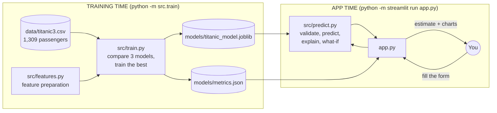
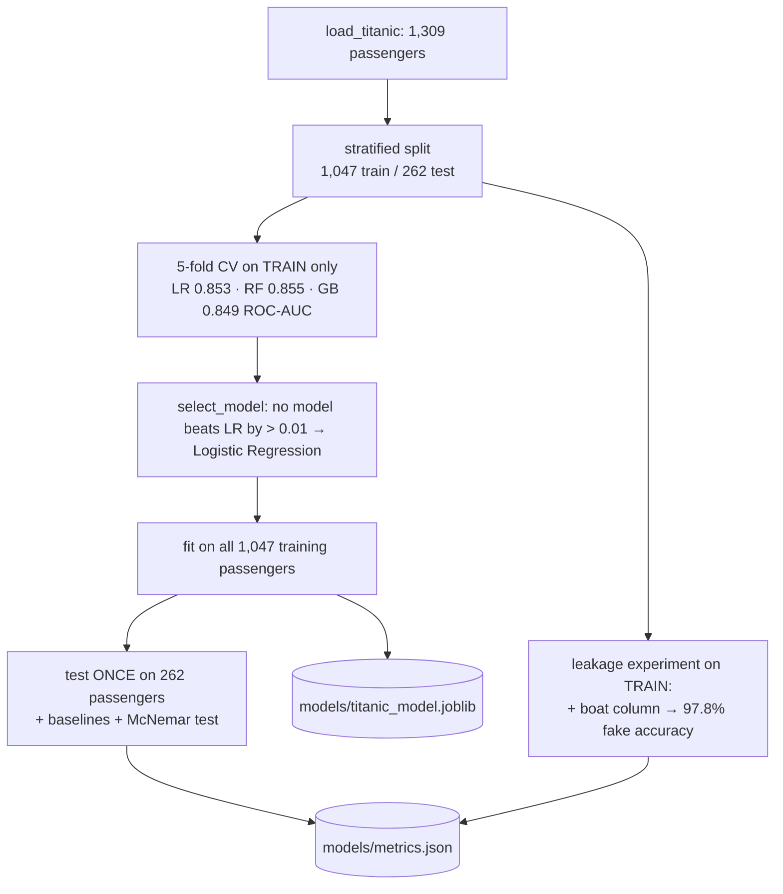
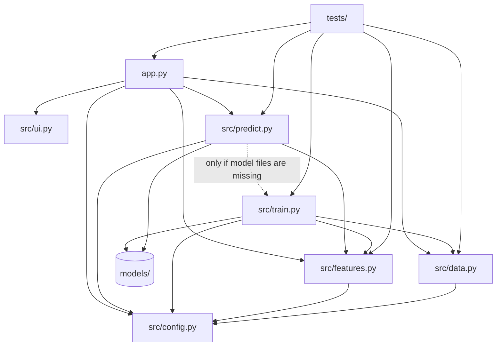

# Project Walkthrough: Titanic Survival Prediction

A beginner-friendly guide to **every file** in this project: what it does, how its important functions
work, and how the passenger details you enter on the website become a survival estimate with an explanation.

Everything here describes the code as it exists in this repository. Numbers marked *real* were produced by
running the actual saved model.

**How to read this:** Sections 1–3 give the big picture. Section 4 is a map of all files. Section 5 explains
each file. Section 6 traces one passenger through the system step by step. Section 7 explains training.
Section 9 is a glossary.

> **A historical-data exercise.** The model describes patterns in the recorded outcomes of 1,309 real
> passengers in 1912. It cannot tell what happened, or would happen, to any particular person.

---

## Contents
1. [The project in one minute](#1-the-project-in-one-minute)
2. [Ideas you need first](#2-ideas-you-need-first)
3. [The two halves: training time and app time](#3-the-two-halves-training-time-and-app-time)
4. [Map of every file](#4-map-of-every-file)
5. [File-by-file explanation](#5-file-by-file-explanation)
6. [End-to-end flow: from the form to the estimate](#6-end-to-end-flow-from-the-form-to-the-estimate)
7. [Training flow: what `python -m src.train` does](#7-training-flow-what-python--m-srctrain-does)
8. [How the files depend on each other](#8-how-the-files-depend-on-each-other)
9. [Glossary](#9-glossary)

---

## 1. The project in one minute

You describe a passenger on a web form: ticket class, sex, age (or "unknown"), number of relatives aboard,
fare and port of embarkation. The page shows:
- an **estimated survival probability**, e.g. 15%;
- a **"Why?" chart** showing which attributes raised or lowered the estimate;
- a **"What if?" chart**: the same passenger in a different class, or with the other sex;
- other tabs with the model's test results, how it works, and charts of the data.

Behind the page is a **machine-learning model**. *Machine learning (ML)* means a program learns a rule from
examples instead of a programmer writing it. The *model* is that learned rule, saved as numbers in a file.
It learned from the **titanic3 dataset**: 1,309 passengers, each with a recorded outcome (survived or not).

---

## 2. Ideas you need first

| Idea | Plain meaning | In this project |
|---|---|---|
| **Feature** | An input the model uses | Class, sex, age, family size, fare, port (after preparation) |
| **Label / target** | The correct answer to learn | `survived`: 1 = survived, 0 = did not |
| **Training** | Adjusting the model's numbers using examples with known answers | `src/train.py` |
| **Prediction / inference** | Using the trained model on new input | `src/predict.py`, every time the form changes |
| **Binary classification** | Predicting one of two outcomes | survived / did not survive |
| **Probability** | A number from 0 to 1 for how likely something is | e.g. 0.15 = 15% |
| **Tabular data** | Data in a table: rows (passengers) × columns (attributes) | `data/titanic3.csv` |

Real data has problems the model must cope with: **missing values** (age is unknown for 263 passengers),
**text categories** ("male", "S") that must become numbers, and **columns that would cheat** (see "leakage" in §5.1).

---

## 3. The two halves: training time and app time



The trained model and the dataset are already included, so the app works immediately. If the model files
are missing, the app trains automatically on start-up (`ensure_trained`, §5.5).

---

## 4. Map of every file

```
titanic-survival-prediction/
├── app.py                    ← the website (Streamlit): form, charts, 4 tabs
├── src/
│   ├── __init__.py           ← empty; makes src/ an importable Python package
│   ├── config.py             ← settings: paths, input columns, excluded columns, limits
│   ├── data.py               ← loads the CSV (downloads and verifies it if missing)
│   ├── features.py           ← feature engineering + preprocessing (missing values, encoding, scaling)
│   ├── train.py              ← compares 3 models, picks one, evaluates, runs extra experiments, saves
│   ├── predict.py            ← validates input, predicts, explains, "what if"
│   └── ui.py                 ← styling helpers (banner, result card, footer)
├── data/titanic3.csv         ← the dataset (117 KB; its publisher allows anyone to use it)
├── models/
│   ├── titanic_model.joblib  ← the trained model (preprocessing + logistic regression)
│   └── metrics.json          ← every number shown on the Model card, plus explanation data
├── assets/                   ← a public-domain 1912 photo + ATTRIBUTIONS.md
├── tests/
│   ├── test_model.py         ← checks of data, features, prediction, explanations, statistics
│   └── test_app.py           ← checks of the website without a browser
├── docs/                     ← MODEL_CARD, DATA_SOURCES, DEVELOPMENT_LOG, TESTING
├── .streamlit/config.toml    ← light and dark theme colours
├── requirements.txt, pytest.ini, .gitignore, README.md
```

**Design rule:** `app.py` controls how things look; `src/` does all the computing and never imports
Streamlit (the web framework), so it can be tested without a browser.

---

## 5. File-by-file explanation

### 5.1 `src/config.py`: shared settings

| Constant | Meaning |
|---|---|
| `DATA_PATH`, `DATA_URL`, `DATA_SHA256` | Where the CSV lives, where to download it from, and its *checksum*: a fingerprint used to verify the file wasn't changed or corrupted |
| `TARGET = "survived"` | The column the model predicts |
| `INPUT_FEATURES` | The 7 raw inputs: `pclass` (ticket class 1/2/3), `sex`, `age`, `sibsp` (siblings + spouses aboard), `parch` (parents + children aboard), `fare` (1912 pounds), `embarked` (port: S/C/Q) |
| `EXCLUDED_COLUMNS` | Columns deliberately **not** used, each with the reason. `boat` (lifeboat number) and `body` (body identification number) were only known *after* the disaster, so using them would be cheating. That kind of cheating is called **data leakage**: information that would not be available at prediction time leaking into the model |
| `PORTS`, `CLASS_NAMES` | Readable names, e.g. `S → Southampton`, `1 → 1st class` |
| `LIMITS` | Hard limits for the form: age 0–100, relatives 0–10, fare 0–1000 |
| `RANDOM_STATE = 42` | *Random seed*: makes every run give the same results |
| `TEST_SIZE = 0.2`, `CV_FOLDS = 5` | 20% of passengers are kept for the final test; 5 rounds of cross-validation |
| `DEFAULT_THRESHOLD = 0.5` | Above 50% the wording says "leans towards survival" |

### 5.2 `src/data.py`: loading the data
- `ensure_data()`: if `data/titanic3.csv` is missing, downloads it, computes its SHA-256 checksum with `_sha256()`, and refuses the file if the checksum doesn't match.
- `load_titanic()`: returns the full table (1,309 rows, 14 columns) as a pandas **DataFrame**, a spreadsheet-like table object in Python.

### 5.3 `src/features.py`: preparing the data for the model

A model needs **numbers with no gaps**. This file turns raw passenger details into exactly that, in two layers.

**Layer 1: `add_features(df)` creates new, more useful columns.** This is called **feature engineering**.

| New feature | How it is made | Why |
|---|---|---|
| `family_type` | family size = `sibsp + parch + 1`, then bucketed by `family_type()`: 1 → `alone`, 2–4 → `small`, 5+ → `large` | Survival was not "more family = better": small families did best, large families worst |
| `log_fare` | `log(1 + fare)` | Fares range from £0 to £512, but most are under £30. The logarithm squeezes the large values so a few very expensive tickets don't dominate |
| `sex_class` | sex + "_" + class, e.g. `"male_3"` | An **interaction feature**: being female helped hugely in 1st class but much less in 3rd. A linear model can't learn "the effect of A depends on B" unless the combination is given to it |
| `is_child` | `"yes"` if age ≤ 12 (`CHILD_MAX_AGE`), otherwise `"no"`; unknown age counts as `"no"` | "Women and children first" |

It returns only the columns the model uses: `age`, `log_fare` (numbers) and `sex_class`, `is_child`,
`embarked`, `family_type` (categories).

**Layer 2: `build_preprocessor()` makes everything numeric and gap-free.** It returns a **Pipeline** (a
chain of steps run in order): first `add_features`, then a **ColumnTransformer** (which applies different steps
to different columns):

- **Numeric columns** (`age`, `log_fare`):
  1. `SimpleImputer(strategy="median", add_indicator=True)`. **Imputation** means filling missing values: a missing age is filled with the **median** (middle value) age of the training passengers, which is 28. `add_indicator=True` also adds a 0/1 column, "this value was missing". The fact that age is unknown is itself informative: passengers without a recorded age survived less often.
  2. `StandardScaler()` **standardises** each resulting column: `z = (x − mean) / std`, giving average 0 and spread 1 (*std* = standard deviation, a measure of spread). This applies to the values and to the "was missing" columns.
- **Category columns** (`sex_class`, `is_child`, `embarked`, `family_type`):
  1. `SimpleImputer(strategy="most_frequent")` fills a missing port with the most common one.
  2. `OneHotEncoder(handle_unknown="ignore")`. **One-hot encoding** turns one category column into several 0/1 columns, one per possible value. For example, `embarked = S` becomes `embarked_C = 0, embarked_Q = 0, embarked_S = 1`. This avoids pretending categories have an order.

Result: **18 numeric columns** for every passenger.

**Why do all of this inside a pipeline?** The medians, means and category lists are *learned from the training
passengers only*, then saved inside the model file. At prediction time, your form input goes through
**exactly the same** steps. Learning them from all passengers, including the test ones, would be data leakage.

**`raw_feature_of(encoded_name)`** maps each of the 18 encoded column names back to the input it came from,
e.g. `cat__sex_class_female_1 → "sex & class"`, `num__missingindicator_age → "age"`. The "Why?" chart uses
this to group contributions by input.

### 5.4 `src/train.py`: learning and evaluating

Run with `python -m src.train` (about 40 seconds).

| Function | What it does |
|---|---|
| `build_candidates()` | Three candidate models, each = preprocessing + classifier (below) |
| `select_model(cv_results)` | **Keeps Logistic Regression unless another model's ROC-AUC is better by more than 0.01**, because Logistic Regression can be explained exactly |
| `leakage_experiment(train_df, cv)` | Trains the same model *with* a "had a lifeboat" column, to show how much cheating would inflate the score |
| `mcnemar_vs_rule(...)` | A statistical test: is the model really better than a one-line rule? |
| `_metrics(y_true, y_pred)` | Computes accuracy, precision, recall and F1 |
| `train_and_evaluate()` | The whole procedure (below) |
| `main()` | Saves the model (`joblib`) and metrics (`JSON`), and prints a summary |

**The three candidate models:**
- **Logistic Regression**: adds up weighted features into a score, then turns the score into a probability with the **sigmoid** function `1 / (1 + e^(−score))`. Each weight says how much a feature pushes survival up or down.
- **Random Forest**: 300 *decision trees* (flowcharts of yes/no questions), each trained on a random sample of the data; their votes are averaged.
- **Gradient Boosting** (`HistGradientBoostingClassifier`): trees built one after another, each correcting the previous ones' mistakes.

**`train_and_evaluate()` step by step (real results):**
1. Load 1,309 passengers.
2. **Split**: 1,047 for training, 262 for the final test. The split is *stratified*, so both parts keep the same 38% survival rate. The test set is the "final exam", used only once at the end.
3. **Cross-validation** on the training passengers: split them into 5 parts (*folds*), train on 4 and score on 1, rotate, and average. Two scores are recorded:
   - **accuracy**: share of correct predictions;
   - **ROC-AUC**: the chance the model gives a random survivor a higher score than a random non-survivor (1.0 is perfect, 0.5 is guessing).
   Real ROC-AUC: Logistic Regression 0.853, Random Forest 0.855, Gradient Boosting 0.849.
4. **Select**: Random Forest leads by only 0.0015, less than 0.01, so **Logistic Regression** is kept.
5. **Fit** (train) it on all 1,047 training passengers.
6. **Test once** on the 262 test passengers (real):
   - accuracy 0.817, precision 0.795, recall 0.700, F1 0.745, ROC-AUC 0.876;
   - **Brier score** 0.130: the average squared gap between predicted probability and actual outcome (lower is better);
   - **confusion matrix** `[[144, 18], [30, 70]]` (rows = actual, columns = predicted).
   - **Precision** = of passengers predicted to survive, the share who did; **recall** = of passengers who survived, the share predicted; **F1** = one number balancing both.
7. **Baselines**: very simple rules to compare against. "Always predict did not survive" scores 61.8%; **"women survive, men do not"** scores 80.2%.
8. **McNemar test** (`mcnemar_vs_rule`): looks only at passengers where exactly one of model and rule was right. The model was right where the rule was wrong for 15 passengers, and the reverse for 11. If both were equally good, these splits would be like coin flips. The resulting **p-value** is 0.557, the probability of seeing a difference this large by chance. That's far above the usual 0.05 cut-off, so the 1.5-point difference is **not statistically significant**.
9. **Explanation data**: stores the model's 18 weights (*coefficients*), its intercept (constant term), and the **reference point**: the average encoded training passenger. These drive the "Why?" chart.
10. **Leakage experiment**: with the "had a lifeboat" column, CV accuracy jumps from 79.4% to **97.8%**: fake skill, because the lifeboat is only known after the outcome.
11. **Training statistics** for the form: age range, maximum relatives and fare, and the median fare per class.

### 5.5 `src/predict.py`: from the form to an answer

| Function | What it does |
|---|---|
| `ensure_trained()` | Trains if the model or metrics file is missing |
| `load_model()`, `load_metrics()` | Read the saved files |
| `validate_passenger(p)` | Returns a list of errors: missing fields, class not 1/2/3, unknown sex or port, non-numbers, values outside `LIMITS`, fractional relatives. `age = None` is allowed (unknown) |
| `range_warnings(p, stats)` | Gentle warnings when a value is outside what training passengers had (e.g. a fare above £512). Predicting beyond the training range is called **extrapolation** |
| `to_frame(p)` | Turns the form dictionary into a 1-row table; unknown age becomes `NaN` ("not a number", a missing-value marker), which the imputer then fills |
| `predict_survival(model, p)` | Validates, then returns `model.predict_proba(...)[0, 1]`, the survival probability |
| `explain_passenger(model, p, explanation)` | Exact per-input contributions (see §6, step 6) |
| `what_if(model, p, field, options)` | Re-predicts with one field changed and everything else kept the same |

### 5.6 `src/ui.py`: styling helpers
`inject_css()` adds CSS (web styling rules) for the banner and cards, using colours that work in light and
dark mode. `hero()` draws the banner plus the light/dark hint, `result_card()` draws the estimate box, and
`footer()` the bottom line. Text is HTML-escaped (special characters are shown, never run). `style_fig`,
`NEUTRAL` and `PLOT_MARGIN` exist here but are not currently used by `app.py`.

### 5.7 `app.py`: the website

Built with **Streamlit**, which turns a Python script into a web page at http://localhost:8501. **Key fact:**
every change on the form makes Streamlit **re-run the whole script** and redraw the page.
- `@st.cache_resource` (on `get_model_and_metrics`) and `@st.cache_data` (on `get_data`) load the model and data **once**. This is called *caching*.
- `st.session_state` is per-visitor memory that survives reruns. Each form field has a key there (`pclass`, `sex`, `age`, …).

| Function | Role |
|---|---|
| `PRESETS`, `DEFAULT` | Four example profiles (not real people). The default is "3rd-class man, 25, alone" |
| `apply_preset(name)` | Button callback: writes a preset's values into session state, unticks "Age unknown", ticks "typical fare" |
| `render_form(metrics)` | Draws the preset buttons and form fields. If "typical fare" is ticked, the fare is the **median training fare for the chosen class** (e.g. £8.05 for 3rd class). Returns the passenger dictionary |
| `render_prediction(model, metrics, p)` | Estimate card, probability bar with the overall 38% survival line, "how to read" caption, range warnings, and an "age unknown" note |
| `render_explanations(model, metrics, p)` | The "Why?" chart (`explain_passenger`) and the "What if?" chart (`what_if` for class 1/2/3 and both sexes) |
| `render_predict(model, metrics)` | The **Predict** tab: historical-data notice, form, validation errors, estimate, explanations |
| `render_model_card(metrics)` | Metrics, baseline comparison and McNemar result, confusion matrix, ROC curve, CV table, leakage experiment, learned weights |
| `render_how_it_works(metrics)` | Pipeline steps, the formula, excluded columns, limitations |
| `render_insights(df, metrics)` | 1912 photo, survival by sex × class, by age group, by family size, and a missing-values table |
| `main()` | Page set-up → load model and data → default form values → banner → 4 tabs → footer |

Charts are drawn with **Plotly** (interactive charts).

### 5.8 `tests/`: automatic checks
Run with `python -m pytest`. *pytest* runs every `test_…` function; a test fails if an `assert` is false.

- **`test_model.py`** (24 cases):
  - **Data:** dataset checksum and shape.
  - **Features:** feature engineering on hand-made rows.
  - **No leakage:** no encoded column contains boat/body/name/ticket/cabin.
  - **Stored metrics:** recomputed from the saved model, they equal `metrics.json`.
  - **Baselines and patterns:** beats the majority baseline; historical patterns hold (1st-class woman > 85%, 3rd-class man < 20%, boy > man).
  - **Unknown age:** accepted.
  - **Invalid inputs:** 10 cases rejected.
  - **Range warnings.**
  - **Explanations:** `test_explanation_adds_up_exactly` checks sigmoid(reference + contributions) equals the model's probability.
  - **What-if and mapping:** what-if checks; encoded-name mapping.
  - **Selection rule.**
  - **McNemar:** the counts come from the same predictions.
  - **What-if:** keeps the other inputs fixed.
- **`test_app.py`** (3 tests) uses Streamlit's **AppTest** (runs the page without a browser):
  - the page renders;
  - presets change the estimate;
  - "age unknown" and a £900 fare produce the expected note and warning.

### 5.9 Other files

| File | What it is |
|---|---|
| `models/titanic_model.joblib` | Saved Pipeline: preprocessing (with learned medians, means and categories) + logistic regression |
| `models/metrics.json` | All evaluation numbers, baselines, McNemar test, leakage experiment, explanation data, training statistics |
| `assets/` | The public-domain photo (illustration only) and its attribution |
| `.streamlit/config.toml` | Light and dark colours; enables the ⋮ → Settings → Theme switch |
| `requirements.txt` | Exact library versions (including `scipy` for the McNemar test) |
| `pytest.ini`, `.gitignore` | Test settings; files Git should not upload |

---

## 6. End-to-end flow: from the form to the estimate

We follow the **default passenger** with **real numbers**: *3rd class, male, age 25, no relatives, port
Southampton, typical fare*.

```mermaid
sequenceDiagram
    participant You
    participant App as app.py
    participant Pred as src/predict.py
    participant Model as Saved Pipeline<br/>(add_features → impute/encode/scale → logistic regression)
    You->>App: change a field or click a preset
    App->>App: rerun script; model comes from cache
    App->>App: render_form() → passenger dictionary
    App->>Pred: validate_passenger(p) → no errors
    App->>Pred: predict_survival(model, p)
    Pred->>Model: predict_proba(1-row table)
    Model-->>Pred: 0.1475
    App->>Pred: explain_passenger(), what_if()
    Pred-->>App: contributions; what-if probabilities
    App-->>You: "15%", Why? chart, What if? chart
```

**Step 1. Form → dictionary.** "Typical fare" is ticked, so the fare is the 3rd-class median **£8.05**.
`render_form` returns:
`{pclass: 3, sex: "male", age: 25.0, sibsp: 0, parch: 0, fare: 8.05, embarked: "S"}`.

**Step 2. Validation.** `validate_passenger` checks every rule and finds no errors. *(Age 150 would give
"age must be between 0 and 100." and the estimate would not be shown.)*

**Step 3. Feature engineering** (`add_features`, inside the model). Real result:

| age | log_fare | sex_class | is_child | embarked | family_type |
|---|---|---|---|---|---|
| 25.0 | 2.203 (= log(1 + 8.05)) | male_3 | no | S | alone |

**Step 4. Imputation, encoding, scaling.** Nothing is missing here. Age is standardised with the learned
training mean 29.28 and std 12.86: (25 − 29.28) / 12.86 = **−0.333**. The categories become 0/1 columns, e.g.
`sex_class_male_3 = 1`, `embarked_S = 1`, `family_type_alone = 1`, and all other category columns 0. That
makes **18 numbers** in total.

**Step 5. Logistic regression.** The model computes `score = intercept + Σ weight × value` over the 18 columns.
The real score is **−1.755**; sigmoid gives `1 / (1 + e^(1.755))` = **0.1475**, so the card shows **15%**. This is
below 50%, so the wording is "leans towards not surviving".

**Step 6. "Why?" explanation** (`explain_passenger`). Instead of explaining against zero, it compares this
passenger with the **reference passenger**: the average of all encoded training passengers, whose own score is
−0.506 (≈ 37.6% survival). For each column: `contribution = weight × (this passenger's value − reference value)`.
For example, `sex_class_male_3`: weight −1.668 × (1 − 0.382) = **−1.030**. Summing the 18 columns by input (via
`raw_feature_of`) gives the real chart values:

| Input | Contribution (log-odds) |
|---|---|
| Sex & class | **−1.105** |
| Port of embarkation | −0.137 |
| Fare | −0.107 |
| Age | +0.007 |
| Family aboard | +0.092 |
| **Total** | −0.506 (reference) − 1.249 = **−1.755** → 14.7% |

The total equals the model's own score exactly, because logistic regression is a plain weighted sum. These
are *associations in the 1912 data*, not causes.

**Step 7. "What if?"** (`what_if`). This re-runs `predict_survival` with one field changed and everything else
the same (including the £8.05 fare). Real results: 1st class **28.6%**, 2nd class 13.4%, 3rd class 14.7%;
as a woman **47.4%**.

**Step 8. Warnings.** Nothing is outside the training ranges, so there are no warnings. *(With a fare of £900
you'd see "Fare £900 is higher than any training fare (£512).". With "Age unknown" ticked, age becomes NaN,
the imputer fills in the training median of 28, the "age was missing" column becomes 1, and the estimate
becomes 13.3%.)*

**Step 9. Display.** The estimate card, probability bar, "how to read" note and both charts are sent to your
browser. Any change on the form repeats steps 1–9; the model is not reloaded.

---

## 7. Training flow: what `python -m src.train` does



**Overfitting** (memorising the training passengers instead of learning general patterns) would show up as
much worse results on the test set. That's why the test set is kept separate and used only once.

---

## 8. How the files depend on each other



`features.add_features` is stored **inside** the saved model. That's why `src/features.py` must be importable
whenever the model is loaded, and why training and prediction always apply identical preparation.

---

## 9. Glossary

| Term | Simple meaning |
|---|---|
| **Accuracy** | Share of correct predictions |
| **AppTest** | Streamlit tool that runs the page in a test without a browser |
| **Baseline** | A very simple rule used for comparison |
| **Binary classification** | Predicting one of two outcomes |
| **Brier score** | Average squared difference between predicted probability and actual outcome (lower is better) |
| **Caching** | Keeping a loaded result in memory for reuse |
| **Checksum (SHA-256)** | A fingerprint of a file, used to verify it is unchanged |
| **Coefficient / weight** | A number learned for each feature |
| **ColumnTransformer** | Applies different processing to different columns |
| **Confusion matrix** | Table of actual vs predicted outcomes |
| **Cross-validation** | Repeated train/score rounds on the training data, for fair comparison |
| **Data leakage** | Using information that wouldn't be available at prediction time, which makes scores fake |
| **DataFrame** | A table object from pandas |
| **Decision tree / Random forest / Gradient boosting** | A flowchart model / many trees voting / trees built to correct each other |
| **Extrapolation** | Predicting for inputs outside the training range |
| **F1-score** | One number balancing precision and recall |
| **Feature engineering** | Creating more useful inputs from raw data |
| **Imputation** | Filling missing values (here: median or most frequent value) |
| **Interaction feature** | A feature combining two others, so their joint effect can be learned |
| **Intercept** | The model's constant term |
| **Logistic regression** | Weighted sum → sigmoid → probability |
| **Log-odds** | log(P / (1 − P)); the scale on which logistic regression adds things up |
| **McNemar test** | A test of whether two classifiers differ in accuracy on the same cases |
| **Median** | The middle value when sorted |
| **Missing indicator** | A 0/1 column marking that a value was missing |
| **NaN** | "Not a Number": the marker for a missing value |
| **One-hot encoding** | One category column → several 0/1 columns |
| **Overfitting** | Memorising training data instead of learning general patterns |
| **p-value** | Probability of a difference this large by pure chance; above 0.05 is usually "not significant" |
| **Pipeline** | Processing steps chained into one object |
| **Precision / Recall** | Of predicted survivors, the share correct / of actual survivors, the share found |
| **Reference passenger** | The average encoded training passenger, used as the comparison point in "Why?" |
| **ROC-AUC** | Probability the model ranks a random survivor above a random non-survivor |
| **Sigmoid** | `1 / (1 + e^(−x))`: turns a score into a probability |
| **Session state** | Streamlit's per-visitor memory across reruns |
| **Standardisation** | Rescaling to mean 0, spread 1 |
| **Stratified split** | A split keeping the same outcome mix in each part |
| **Test / training set** | Data kept for the final check / data used for learning |
| **What-if analysis** | Changing one input and observing how the prediction changes |
