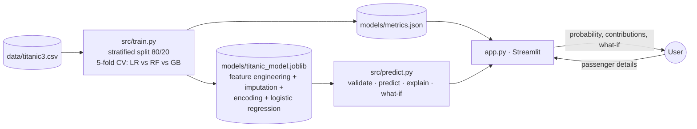

# 🚢 Titanic Survival Prediction

An interactive application that estimates how likely a passenger with a given profile was to survive the
sinking of RMS Titanic (15 April 1912), and explains which factors drive the estimate.

**Author:** Arya Kumar · AI/ML internship project

> **A historical-data exercise.** The model describes patterns in the recorded outcomes of 1,309 real
> passengers. It does not determine what happened, or would happen, to any individual.

---

## Problem statement

Survival on the Titanic was far from random: the "women and children first" protocol and unequal access
to lifeboats by ticket class strongly shaped who lived. The task is to learn these patterns from passenger
records with a leakage-free pipeline, evaluate the model against simple baselines, and present the
estimate with honest explanations.

### Objectives
1. Build a reproducible preprocessing pipeline that handles missing values and engineers meaningful features.
2. Compare an interpretable model with tree ensembles using cross-validation.
3. Evaluate against simple baselines, including the strong rule "women survive, men do not".
4. Demonstrate, with numbers, why some columns would be **data leakage**.
5. Explain every individual estimate exactly.

## Features

| Area | What it does |
|---|---|
| **Predict** | Passenger form (class, sex, age or *unknown*, family aboard, fare or class-typical fare, port) and four example profiles |
| **Estimate** | Survival probability, compared with the overall survival rate of 38% |
| **Why?** | Exact contribution of each attribute compared with an average passenger |
| **What if?** | The same passenger in a different class or with the other sex |
| **Input checks** | Hard validation (e.g. age 0–100) plus warnings outside the training range |
| **Model card** | Metrics, comparison with baselines, confusion matrix, ROC curve, CV model comparison, **leakage experiment**, learned weights |
| **Data insights** | Survival by sex × class, by age group, by family size; missing-value table |

## Technology stack
Python 3.13 · scikit-learn 1.9 (Pipeline, ColumnTransformer, SimpleImputer, OneHotEncoder, LogisticRegression,
RandomForest, HistGradientBoosting) · pandas · NumPy · Streamlit 1.66 · Plotly · joblib · pytest.

## Dataset
**`titanic3`**, Vanderbilt University Department of Biostatistics (compiled by Thomas Cason from the
*Encyclopedia Titanica*): 1,309 passengers (crew not included), 14 columns. It has more passengers than
the familiar Kaggle training file (891 rows) and needs no login.
*"Data obtained from http://hbiostat.org/data courtesy of the Vanderbilt University Department of
Biostatistics."* The publisher grants permission to anyone to use the data, so a copy is included in
`data/titanic3.csv` (checksum verified). See [docs/DATA_SOURCES.md](docs/DATA_SOURCES.md).

## Architecture



## Quick start (Windows PowerShell)

Requires **Python 3.11 or newer** (tested with 3.13.1 on Windows 11). Run these from a PowerShell window:

```powershell
# 1. Go to the project folder (the one containing app.py)
cd path\to\titanic-survival-prediction

# 2. First time only: create a virtual environment and install the dependencies
py -3.13 -m venv C:\venvs\titanic
C:\venvs\titanic\Scripts\Activate.ps1
python -m pip install -r requirements.txt

# 3. Every time: activate the environment and start the app
C:\venvs\titanic\Scripts\Activate.ps1
python -m streamlit run app.py
```

The app opens at **http://localhost:8501**. Stop it with `Ctrl + C`. Run the tests with `python -m pytest`
(27 tests).

- **Data:** The dataset is included (`data/titanic3.csv`, checksum-verified).
- **Model:** The trained model (`models/titanic_model.joblib`) is included. Retrain (about 40 s): `python -m src.train`.
- **Light / dark mode:** open the **⋮** menu (top right) → **Settings** → **Theme**.

> The virtual environment is created at a short path outside the project folder on purpose: inside a long
> OneDrive path, Windows' 260-character path limit can break the installation (`WinError 206`), and
> OneDrive would sync ~500 MB of packages. If `py -3.13` is not available, use `python -m venv C:\venvs\titanic`.

### Common startup problems

| Symptom | Fix |
|---|---|
| `Activate.ps1 cannot be loaded because running scripts is disabled` | Run `Set-ExecutionPolicy -Scope Process -ExecutionPolicy Bypass`, then activate again (affects this window only) |
| `streamlit` / `python` is not recognised, or `ModuleNotFoundError` | The environment is not active: run the `Activate.ps1` line again; always start the app with `python -m streamlit run app.py` |
| `ModuleNotFoundError: No module named 'src'` | You are not in the project folder; `cd` into the folder that contains `app.py` |
| `Port 8501 is already in use` | Another app is running; stop it, or use `python -m streamlit run app.py --server.port 8502` |
| `WinError 206: The filename or extension is too long` during `pip install` | Create the environment at a short path such as `C:\venvs\titanic` (as above) |
| The browser does not open | Open http://localhost:8501 manually |

## How to use
1. Click an example profile, e.g. **1st-class woman, 38** vs **3rd-class man, 25, alone**.
2. Read the *Why?* chart: which attributes raised or lowered the estimate?
3. Use *What if?* to see the same passenger in another class.
4. Tick **Age unknown**, or enter a fare above £600, to see how the app handles missing and unusual values.
5. Open **Model card** for the evaluation, and the leakage experiment.

## Results (held-out test set: 262 passengers)

**Selected model:** Logistic Regression with engineered interaction features.

| Approach | Accuracy | F1 (survived) |
|---|---|---|
| **This model** | **81.7%** | **0.745** |
| Rule: women survive, men do not | 80.2% | 0.732 |
| Always predict "did not survive" | 61.8% | 0.000 |

ROC-AUC **0.876** · precision 0.795 · recall 0.700 · Brier score 0.130 · confusion matrix TN 144, FP 18, FN 30, TP 70.

5-fold CV on the training set (ROC-AUC / accuracy): Logistic Regression 0.853 / 0.794; Random Forest
0.855 / 0.811; Gradient Boosting 0.849 / 0.801. The forest's ROC-AUC lead (0.0015) is within the 0.01
tolerance, so the fully explainable model was kept.

**Honest reading:** the model is 1.5 percentage points (4 passengers) more accurate than the one-line sex
rule, and an exact McNemar test shows this difference is **not statistically significant** (p = 0.56).
Its value lies in graded probabilities (ROC-AUC 0.876), exact per-passenger explanations, and the cases the
rule ignores (boys, women in 3rd class).

**Leakage experiment:** adding the `boat` column raises CV accuracy from 79.4% to **97.8%**. This
improvement is fake, because lifeboat assignment is only known after the outcome.

## Repository structure
```
titanic-survival-prediction/
├── app.py                  # Streamlit UI (Predict · Model card · How it works · Data insights)
├── requirements.txt · pytest.ini · .gitignore · .streamlit/config.toml
├── data/titanic3.csv       # dataset (117 KB, permission granted by publisher)
├── src/
│   ├── config.py           # paths, features, excluded columns, limits
│   ├── data.py             # load + checksum-verified download
│   ├── features.py         # feature engineering + preprocessing pipeline
│   ├── train.py            # CV comparison, selection, baselines, leakage experiment
│   ├── predict.py          # validation, prediction, exact explanations, what-if
│   └── ui.py               # styling helpers
├── models/                 # titanic_model.joblib + metrics.json
├── tests/                  # test_model.py (24) + test_app.py (3)
├── assets/                 # historical photo (public domain) + ATTRIBUTIONS.md
└── docs/                   # MODEL_CARD · DEVELOPMENT_LOG · DATA_SOURCES · TESTING
```

## Limitations
- Passengers only (no crew); 1,047 training passengers; rare profiles rest on very few examples.
- Ignores where people were on the ship, crew decisions and luck, which determined many outcomes.
- Encodes 1912 social norms and inequality, so it must not be generalised or used to judge people.
- Probabilities are not formally calibrated (Brier score 0.130 is reported).

## Future improvements
- Extract titles (Mr/Mrs/Master…) from names as an additional feature; calibration curve; repeated CV for confidence intervals.

## Documentation
[Model card](docs/MODEL_CARD.md) · [Development log](docs/DEVELOPMENT_LOG.md) ·
[Data sources](docs/DATA_SOURCES.md) · [Testing](docs/TESTING.md)
